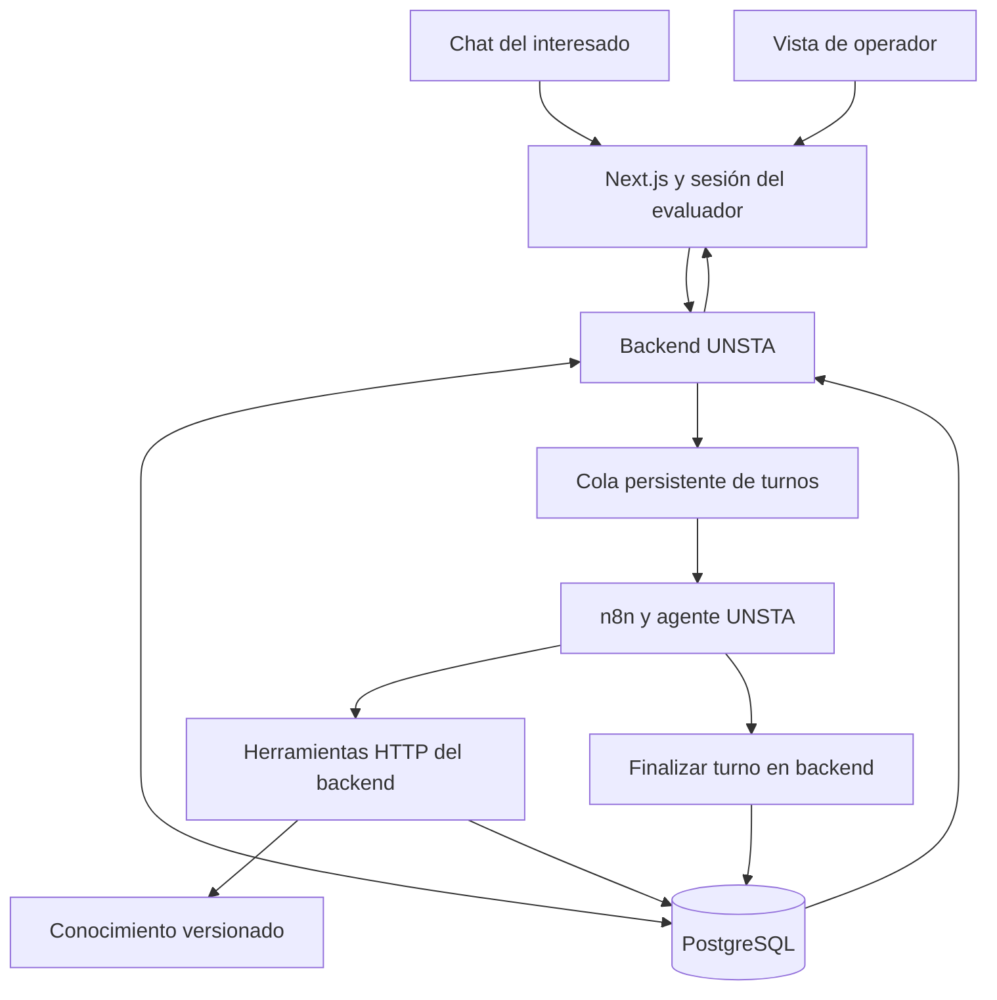

> Documento trasladado desde la demo. Para instalación y comandos actuales, consultar primero el README de este repositorio.

# Plan de implementación de la demo UNSTA en n8n

Fecha: 31 de octubre de 2026. Estado: implementación iniciada. Por indicación del usuario, se prepararon primero los tres workflows locales y su contrato para importación manual en la instancia existente de n8n. El backend local con PostgreSQL ya está implementado y probado por HTTP. Actualización: panel implementado, conversación conectada y prueba en vivo realizada. Quedan calidad de respuestas, avisos y despliegue estable; ver [revisión actual](pendientes-demo-2026-10-31.txt). Ver [guía de importación](importar-n8n.md) y [contrato HTTP](contrato-api-agente.md).

La demo permitirá que una persona converse con el asistente, consulte la base de conocimiento y vea cómo se conserva su información en una ficha de interesado. Desde una vista de operador se podrá tomar el chat, responder, registrar notas y gestionar el seguimiento. Los registros serán persistentes dentro de un entorno de demostración separado de UNSTA y de Lamelas.

## 1. Alcance y decisiones iniciales

| Decisión | Implementación propuesta |
| --- | --- |
| Canal inicial | Chat web dentro del panel de demostración. |
| Orquestación | n8n, con un agente y herramientas HTTP que llaman al backend. |
| Persistencia y reglas | Backend Express + TypeScript + Prisma + PostgreSQL, siguiendo los módulos de Lamelas. |
| Panel | Next.js + componentes reutilizables del panel de Lamelas. |
| Conocimiento | JSON UNSTA versión 1.0.0: 39 registros, 18 fuentes, Central y Yerba Buena, más las propuestas virtuales seleccionadas. |
| Identidad visual del agente | Asistente virtual de demostración de UNSTA; nombre propio pendiente, sin heredar Martina. |
| Datos de prueba | Conversaciones, contactos e intereses reales dentro de la aplicación demo; no constituyen registros institucionales. Usar identidades ficticias para las pruebas. |
| Integraciones institucionales | Una inscripción se puede marcar como simulada. No se consulta el sistema académico ni se acredita un pago. |
| Seguimiento | Tareas y suscripciones persistentes; avisos de apertura simulados dentro del panel. |

WhatsApp, Wise CX, correo saliente a interesados, documentación personal, pagos, audio e imágenes quedan para una etapa posterior. La primera entrega debe demostrar el circuito completo por web. El conector futuro se incorporará sin cambiar las reglas del CRM ni la memoria del agente.

Se mantendrá una única aplicación UNSTA con módulos propios. Se extraerán componentes concretos de Lamelas, con credenciales y base independientes, evitando introducir el dominio universitario en su sistema inmobiliario.

## 2. Experiencia que debe mostrar la demo

1. El miembro invitado inicia sesión y abre el espacio compartido de UNSTA.
2. Inicia una conversación como interesado y pregunta, por ejemplo, por Psicología en Yerba Buena.
3. El sistema crea una ficha provisional y el asistente informa usando la base. El nombre y el contacto se completan durante la conversación, cuando tiene sentido; no condicionan una respuesta informativa.
4. La ficha muestra el interés, sede, modalidad, período consultado y dudas. Cada dato extraído conserva el mensaje que lo respalda.
5. Si pregunta por una cuota de grado ausente de la base, el asistente reconoce el límite y ofrece atención humana. El caso queda en la bandeja del área correspondiente.
6. El evaluador cambia a la vista de operador, toma la conversación y responde. La respuesta aparece en el mismo chat y el bot permanece pausado.
7. El operador agrega una nota, asigna una tarea y actualiza el avance del interés. Puede registrar una inscripción simulada, claramente identificada.
8. En otro escenario, el interesado solicita aviso de un curso. Con su permiso se registra la suscripción. Un botón de prueba genera un evento de apertura ficticio y su aviso visible en el panel.
9. Al recargar, el historial, las notas y los estados siguen disponibles. Al crear una prueba nueva se inicia otra identidad; no se borra la anterior automáticamente.

La demo distingue entre los hechos publicados de la universidad y los eventos simulados. El botón de apertura nunca modifica una ficha oficial de la base de conocimiento.

## 3. Arquitectura y responsabilidades



**Panel:** captura mensajes, muestra resultados y ofrece acciones de operador. Las claves de n8n y del modelo permanecen en el servidor.

**Backend:** autentica, limita el acceso al espacio de prueba, guarda mensajes, administra el control bot/humano, valida las herramientas y confirma cada acción. Es la fuente de verdad de contactos, intereses y seguimientos.

**n8n:** interpreta la consulta, recupera contexto, invoca herramientas y produce una respuesta candidata. No escribe directamente en tablas de negocio ni decide autorizaciones.

**PostgreSQL:** almacena dominio, historial, ejecuciones y trabajos pendientes. Se reutiliza el patrón de outbox de Lamelas con reclamo exclusivo de trabajos. Para el volumen inicial no se propone Redis.

**Transporte web:** el backend devuelve `202` con el identificador de turno luego de guardar el mensaje y encolar el trabajo. El panel consulta novedades incrementalmente cada 2 segundos mientras espera y con menor frecuencia cuando está inactivo. Esto evita depender de una conexión HTTP abierta durante toda la ejecución. El streaming de tokens puede añadirse después.

## 4. Reutilización concreta de Lamelas

Referencias locales revisadas: `lamelas-agent` HEAD `914cf62`, `back-lamelas` HEAD `d08ddb8` y `lamelas` HEAD `68b9c5e`. Los hashes identifican la referencia consultada, no certifican el estado de producción ni excluyen cambios locales. Al extraer componentes se registrará su revisión exacta y el diff usado.

| Origen | Qué conservar | Qué adaptar |
| --- | --- | --- |
| `lamelas-agent/agent-contract/` | Prompt versionado, esquemas, normalización del resumen y validación estructural de workflows. | Identidad UNSTA, herramientas educativas, reglas de conocimiento y evaluaciones. |
| `lamelas-agent/n8n/lamelas-agente-web.json` | Secuencia de contexto, agente y resumen como referencia. | Entrada por turno persistente y finalización asíncrona. No copiar el webhook sincrónico sin cambios. |
| `back-lamelas/src/modules/agent/` | Historial, resumen, toma, liberación y patrón de derivación. | Contactos con varios intereses y enrutamiento por área. |
| `back-lamelas/src/modules/crm/` | Notas, responsables, avances y tareas de gestión. | Etapas de admisión y casos de alumnos. |
| `back-lamelas/src/modules/notifications/` e `incidents/` | Notificaciones internas y seguimiento de errores. | Eventos y vistas de la demo. |
| `back-lamelas/src/modules/agent/followup.*` | Reclamo temporal de trabajos, cancelación y reintentos. | Recordatorios elegidos por el operador y avisos simulados. |
| Auth y contexto de datos del backend | Sesiones, validación Zod, permisos y aislamiento probado. | Roles y espacios de prueba, con nuevas políticas y pruebas. |
| `lamelas/src/components/leads/` y `components/agente/` | Visualización del chat, ficha, toma/liberación y probador. | Intereses académicos, fuentes, tareas y composición de respuestas humanas. |

El panel existente aporta visualización y control de la conversación. La capacidad de escribir y entregar una respuesta humana dentro del chat web se implementará y probará expresamente; no se presume resuelta por copiar esos componentes.

No se trasladan propiedades, vendedores inmobiliarios, reglas de clasificación “fantasma”, textos comerciales ni transporte Zernio. Se conserva el control previo al envío, reforzado en la transacción que publica la respuesta.

## 5. Uso de la base de conocimiento

Fuente canónica: `base-conocimiento/demo-v1/unsta-demo.json`. Las instrucciones están separadas en `instrucciones-demo.txt` y los casos en `casos-demo.json`.

### Carga y consulta

- Importación explícita a `knowledge_versions`, `knowledge_records` y `knowledge_sources`, conservando el JSON original y su hash. Una misma versión con contenido diferente se rechaza; requiere nueva versión.
- Una versión activa por demo. Cada turno queda vinculado a la versión utilizada, incluso si se publica otra durante la conversación.
- Búsqueda por categoría, propuesta, sede y texto normalizado. Añadir alias controlados como “psico”; una referencia ambigua devuelve candidatos y pide aclaración.
- La búsqueda inicial puede usar coincidencias y búsqueda de texto de PostgreSQL. No se requiere embeddings para este recorte.
- El catálogo compacto presenta las 6 carreras y 5 propuestas; el detalle se obtiene por herramienta. No incluir toda la base repetidamente en el prompt.
- Resolver `arancel_ref` y `horario_ref` y entregar los registros referenciados con sus propias condiciones.
- Cada resultado incluye `record_id`, datos, fuentes con URL, estado, período, revisión, condiciones y versión. Las advertencias nunca se separan del dato al recuperar contenido.
- La respuesta visible incluye las fuentes relevantes de manera breve; el panel permite desplegar los registros que se consultaron.

### Reglas temporales y de respuesta

Mantener las distinciones `null`/cero, importe publicado/cotización vigente y fecha inicial pasada/apertura disponible. Las restricciones globales se cargan en el prompt y las de cada registro viajan en la herramienta. No excluir una propuesta porque su fecha inicial pasó: devolverla con el alcance correcto.

La fecha de la base es 31/10/2026; el agente recibe la fecha real del turno y la zona `America/Argentina/Tucuman`. No se inventan precios 2027, cuotas de carreras, aulas ni validaciones de inscripción. La consulta de otra sede o carrera informa que está fuera del recorte y ofrece un canal oficial.

El backend verificará referencias, formatos y permisos. Eso no garantiza por sí solo que toda frase del modelo esté sustentada: la evaluación de respuestas comprobará importes, períodos, condiciones y ausencia de afirmaciones inventadas.

Al habilitar herramientas, adaptar las instrucciones 16–18 al alcance efectivo: confirmar “guardado en esta demo” o “derivado al equipo de la demo” únicamente después de un resultado exitoso. Conservar la prohibición de afirmar una inscripción institucional o una entrega externa no realizada. Esta adaptación vive en el contrato del agente; no cambia los hechos de la base.

## 6. Modelo mínimo de datos

Todas las entidades operativas tendrán identificador, fechas y `demo_workspace_id`. La identidad del espacio se obtiene de la sesión o del contexto autenticado del turno, nunca de un valor elegido por el modelo.

| Entidad | Información principal |
| --- | --- |
| Espacio de prueba | Evaluador propietario, miembros autorizados y configuración de demo. |
| Contacto | Nombre opcional, email/teléfono opcionales, condición declarada de ingresante/alumno/otro y origen. |
| Interés | Contacto, propuesta conocida o texto libre, sede, modalidad, cohorte, etapa, responsable y próxima acción. |
| Conversación | Contacto, canal web, modo de atención, área, responsable, versión de control, resumen y secuencia resumida. |
| Mensaje | Conversación, autor, contenido, secuencia, identificador del cliente, referencias utilizadas y fecha. |
| Caso de atención | Conversación, área solicitada, motivo, resumen, estado y operador. |
| Nota interna | Contacto o interés, autor y contenido; no visible para el interesado. |
| Tarea | Interés/contacto, responsable, vencimiento, estado y resultado. |
| Suscripción | Propuesta de interés, consentimiento explícito y su mensaje de evidencia, fecha y cancelación. |
| Evento de apertura demo | Propuesta, descripción ficticia y marca obligatoria de simulación. |
| Aviso demo | Suscripción y evento, resultado de generación y visualización dentro del panel. |
| Turno del agente | Mensaje entrante, estado, intento activo, versión de conocimiento/prompt, tiempos y fallo. |
| Ejecución y auditoría | Identificadores de correlación, herramientas, resultado, cambios y uso del modelo cuando esté disponible. |

Una conversación nueva puede pertenecer al mismo contacto si se elige continuar su ficha. “Nueva persona de prueba” crea otra. No unir identidades por nombre ni por email no verificado; si se necesita fusión se hará manualmente, dentro del espacio y con auditoría.

La IA puede completar una ficha o interés solamente con datos respaldados por mensajes del interesado. Cada actualización registra el mensaje origen y su autor. Los campos corregidos por el operador se protegen de sobrescrituras automáticas; una discrepancia posterior se presenta para revisión.

### Estados separados

- **Atención:** `bot`, `esperando_humano`, `humano`, `cerrada`.
- **Interés:** `nuevo`, `informado`, `seguimiento`, `preinscripcion_declarada`, `inscripcion_simulada`, `sin_interes`.
- **Caso:** `pendiente`, `tomado`, `resuelto`.
- **Tarea:** `pendiente`, `completada`, `cancelada`.
- **Turno:** `encolado`, `procesando`, `completado`, `fallido`, `cancelado`.

La IA puede registrar que una persona declara haber iniciado la preinscripción. `inscripcion_simulada` es una acción del operador y nunca se muestra como confirmación institucional. Una solicitud de un alumno puede crear un caso sin crear un interés comercial.

## 7. Contrato de herramientas del agente

| Herramienta | Parámetros de negocio | Resultado y controles |
| --- | --- | --- |
| `consultar_conocimiento` | Consulta, categoría y filtros opcionales de propuesta/sede/período. | Registros pertinentes con metadatos; devuelve vacío o ambigüedad explícita. |
| `ver_propuesta` | ID devuelto por catálogo o búsqueda. | Detalle más arancel y horario referenciados; no confirma vacantes. |
| `actualizar_contacto` | Campos expresamente declarados y mensaje de evidencia. | Ficha actualizada o validación fallida. No inventa nombre ni contacto. |
| `registrar_interes` | Propuesta o texto libre, sede/modalidad/período declarados, declaración de preinscripción opcional y evidencia. | Crea o actualiza el interés correspondiente sin borrar otros. Solo admite `preinscripcion_declarada` con evidencia; no registra inscripción institucional ni simulada. |
| `gestionar_aviso` | Crear/cancelar, propuesta y evidencia de consentimiento. | Suscripción de demostración confirmada o rechazada. No envía mensajes externos. |
| `derivar_a_area` | Área, motivo y resumen breve. | Caso creado, estado de atención y confirmación verificable de derivación interna. |

Áreas iniciales: admisiones, alumnos, idiomas, orientación vocacional y Tesorería. Son colas de la demo; que exista la cola de Tesorería no significa que conozcamos su contacto institucional directo.

Los identificadores de conversación, contacto, espacio y turno se inyectan desde el contexto técnico. Los parámetros de negocio se validan con Zod. La herramienta no admite elegir otro contacto ni modificar notas privadas, permisos, estados finales de inscripción o importes.

Las escrituras serán idempotentes. Una suscripción activa por contacto y propuesta, y un único caso pendiente de derivación por conversación. La reutilización de una clave de operación con parámetros distintos devuelve conflicto. Las herramientas de un intento cancelado no pueden continuar modificando datos.

## 8. Workflows de n8n

### WF01 Conversación UNSTA

Nombre propuesto: `unsta-demo-conversacion`.

1. **Webhook autenticado:** recibe `turn_id` y contexto técnico mínimo. Un HTTP exitoso de recepción no equivale a un turno completado.
2. **Reclamar turno:** HTTP al backend; devuelve un intento y una autorización acotada al turno. Si ya fue reclamado o completado, terminar sin ejecutar el modelo.
3. **Obtener contexto:** estado, últimos 20 mensajes, resumen anterior, ficha pública para el agente, catálogo compacto y reglas de la versión de conocimiento fijada.
4. **Comprobar control:** si la conversación no está en modo bot, cancelar el procesamiento automático. Las consultas llegadas mientras espera un humano quedan en el historial y notifican al operador.
5. **Preparar entrada:** fecha real, instrucciones UNSTA, contexto y mensaje actual. Las notas internas no se incluyen por defecto. El mensaje de usuario y las fuentes se tratan como datos, no como configuración.
6. **AI Agent:** modelo con herramientas HTTP. Configurar un límite inicial de 6 iteraciones, tamaño máximo de entrada y tiempo máximo total; ajustar con mediciones.
7. **Preparar salida:** texto y referencias. Si hubo derivación, utilizar la confirmación del backend y producir un único aviso de transición, identificado como pase al equipo de la demo.
8. **Finalizar turno:** el backend valida el intento y publica como máximo una respuesta. Las referencias utilizadas quedan registradas para inspección.
9. **Resumen automático por turno (implementado 31/10/2026):** después de cada respuesta publicada del asistente, incluidas derivaciones, extraer y normalizar contexto. Guardar con secuencia de origen y autenticación del intento original; una toma humana posterior no invalida el resumen ya generado y nunca se sobrescribe un horizonte más reciente. La atención exclusivamente humana no dispara nuevos resúmenes. Un fallo de resumen no elimina ni duplica la respuesta ya publicada.

Se parte del modelo configurado en los artefactos de Lamelas como referencia de comparación, sin asumir que es la elección óptima. Antes de implementarlo se comprueba compatibilidad con los nodos de la instancia y se fija la versión elegida. El modelo y sus límites serán configuración; las pruebas decidirán cambios.

Los actuales nodos AI Agent de n8n trabajan con herramientas; verificar las versiones de nodos al importar los artefactos de Lamelas y no promover tipos obsoletos. [Documentación oficial](https://docs.n8n.io/integrations/builtin/cluster-nodes/root-nodes/n8n-nodes-langchain.agent/)

### WF02 Errores del agente

Nombre propuesto: `unsta-demo-errores`.

Error Trigger → normalizar y quitar secretos → reportar incidente al backend. Registrar workflow, nodo, ejecución y turno cuando estén disponibles. El reporte no reenvía la conversación completa ni genera alertas externas.

Asignar este workflow en la configuración de errores de los flujos correspondientes. Los fallos del disparador pueden no incluir los mismos datos que los de ejecución; el backend también necesita detectar turnos estancados. [Documentación oficial](https://docs.n8n.io/flow-logic/error-handling/)

### WF03 Apertura simulada de curso

Nombre propuesto: `unsta-demo-apertura`.

Webhook autenticado, invocado desde el botón del operador → reclamar evento demo → consultar suscripciones vigentes → generar aviso interno por destinatario → registrar resultado.

El backend exige permiso previo, deduplica por evento y suscripción y etiqueta cada aviso como simulado. El texto del aviso puede usar una plantilla determinista; este flujo no necesita otra llamada al modelo. Si la suscripción fue cancelada antes de generar el aviso, se omite.

Las tareas vencidas y la recuperación de turnos se procesan en el worker del backend. No duplicar esas reglas en un cron de n8n.

## 9. Fiabilidad del recorrido completo

### Mensajes repetidos, simultáneos y reintentos

- El navegador genera `client_message_id`. Una restricción por conversación evita duplicar el mensaje por doble clic o reintento HTTP.
- Guardar mensaje y trabajo pendiente en una misma transacción. El worker reclama el trabajo con un lease antes de llamar a n8n.
- Una sola ejecución activa por conversación. Los mensajes siguientes quedan ordenados; distintas conversaciones pueden procesarse simultáneamente.
- El webhook debe reclamar también el turno: un reenvío del worker no puede activar dos respuestas.
- Un tiempo máximo inicial de 90 segundos por intento permite detectar ejecuciones sin cierre. El backend invalida el intento antes de permitir otro. Máximo inicial de 2 intentos; agotados, mostrar el fallo y ofrecer reintento manual o atención humana.
- Si hubo herramientas ya aplicadas, el reintento reutiliza los resultados o detecta la operación existente. No reejecutar a ciegas acciones de negocio.

### Intervención humana

Tomar o cerrar la conversación incrementa su versión de control e invalida intentos automáticos pendientes. `finalizar turno` comprueba esa versión, el intento activo y el modo dentro de una transacción: si el operador tomó el chat durante la generación, la respuesta candidata se descarta.

La única excepción en `esperando_humano` es el aviso del mismo handoff exitoso: se valida el ID de caso y la versión resultante de esa transición. Una derivación histórica no autoriza otro mensaje automático. Si el operador ya tomó el caso, también se descarta ese aviso tardío.

Responder como operador es una operación del backend que exige modo humano y autorización; no pasa por el modelo. Devolver al bot habilita turnos nuevos, sin contestar automáticamente todos los mensajes históricos.

### Sin operador disponible

Para la demo, derivar crea un caso visible en la cola del área aunque todavía no tenga responsable. Se informa que quedó pendiente dentro de la demo, sin prometer plazos. Se muestra una alerta al administrador. No dejar casos invisibles ni implementar un reparto entre vendedores que no corresponde al circuito universitario.

## 10. API mínima prevista

Los nombres son contrato propuesto para implementar, no endpoints ya existentes.

| Superficie | Operaciones |
| --- | --- |
| Evaluador | Crear espacio/persona de prueba; iniciar conversación; enviar mensaje; leer mensajes y estado de turno. |
| Operador | Listar contactos e intereses; consultar ficha; agregar nota; cambiar etapa; tomar/liberar/cerrar chat; enviar respuesta humana. |
| Seguimiento | Crear/completar/cancelar tareas; consultar/cancelar suscripciones; simular apertura y ver avisos. |
| Conocimiento | Catálogo y consulta de registros; administrador importa una versión validada. |
| n8n | Reclamar turno; obtener contexto; ejecutar herramientas; finalizar/fallar turno; guardar resumen; reportar incidente. |

Todas las respuestas de escritura devuelven entidad e identificador persistidos. Los errores distinguen validación, falta de autorización, conflicto, recurso inexistente y fallo temporal, con mensajes claros en español.

La autenticación backend → n8n usa una credencial Header Auth dedicada. n8n → backend usa identidad de servicio y contexto acotado al turno. El webhook no se expone directamente al navegador. n8n diferencia las URLs de prueba y publicadas: la demo compartida utilizará la URL del workflow publicado. [Webhook oficial](https://docs.n8n.io/integrations/builtin/core-nodes/n8n-nodes-base.webhook/)

## 11. Panel simple

### Probar asistente

Chat, ejemplos de preguntas y acción “Nueva persona de prueba”. Mostrar nombre de demo, estado de atención, procesamiento y errores con reintento. Una ficha lateral permite observar cómo aparecen nombre, intereses y próxima acción. Las fuentes de una respuesta se pueden desplegar sin mostrar prompts ni trazas internas al interesado.

### Interesados

Tabla con nombre, contacto, propuestas de interés, sede, etapa por interés, responsable, última interacción y próxima acción. Filtros por carrera/curso, sede, etapa y pendientes. Los casos de alumnos sin interés académico también deben ser localizables.

### Ficha de interesado y vista de operador

Historial, resumen, intereses separados, notas internas, tareas, consentimientos y casos. Acciones: tomar chat, escribir respuesta, devolver al bot, cerrar, cambiar responsable y registrar inscripción simulada. Las notas no deben aparecer como mensajes enviados.

### Seguimiento

Tareas pendientes, suscripciones por curso y botón “Simular apertura”. Vista del aviso generado, destinatarios omitidos por falta de permiso y resultado. No aparentar una entrega por WhatsApp o email.

### Estado de la demo

Vista administrativa compacta: versión de conocimiento y prompt, ejecuciones fallidas, tiempo de respuesta y estado de conexión con n8n. La disponibilidad de n8n se valida con un chequeo/ejecución controlada; “sin errores” no demuestra que el agente esté funcionando.

## 12. Acceso y entorno

- Acceso mediante cuentas invitadas. Todos los miembros invitados comparten el espacio institucional UNSTA y pueden usar las vistas de interesado y operador. Las sesiones son individuales; los datos del cliente son compartidos.
- Aplicar autorización en backend y políticas de datos; ocultar botones en el panel no basta. Probar que dos miembros invitados ven y gestionan los mismos datos de UNSTA, y que una sesión ausente o vencida no accede al sistema.
- Instancia n8n compatible y workflows separados; base PostgreSQL propia para UNSTA. Reutilizar la infraestructura de despliegue solo después de revisar capacidad y aislamiento.
- Credenciales en configuración del servidor y almacén de credenciales n8n; exportar workflows sin secretos ni datos personales de ejecuciones.
- Definir límites por sesión y espacio, y un interruptor global que pause nuevas respuestas automáticas sin impedir atención humana.
- Registrar `turn_id`, `execution_id`, versiones, latencia, errores y uso del modelo cuando lo reporte. El historial vive en las tablas protegidas; minimizar su duplicación en logs.
- Permitir eliminar un espacio de prueba de forma explícita. Configurar y documentar la retención de ejecuciones de n8n antes de compartir la demo.

Quedan para el comienzo del desarrollo: URL y versión de n8n, credencial del modelo, destino de backend/PostgreSQL y lista inicial de evaluadores. No impiden definir el contrato ni construir las primeras piezas localmente.

## 13. Plan de trabajo y criterios de aceptación

| Fase | Trabajo | Entregable verificable |
| --- | --- | --- |
| 0. Contratos | Fijar alcance web, esquema de datos, estados, herramientas, permisos y ejemplos. | Contratos versionados y un escenario de punta a punta documentado. |
| 1. Backend y conocimiento | Crear proyecto separado, migraciones, contexto de demo, importador, búsqueda, contactos, intereses e historial. | Desde API se recupera una ficha persistente y una consulta devuelve datos con fuentes y restricciones. |
| 2. n8n funcional | Adaptar contrato de Lamelas, generar WF01/WF02, publicar en entorno demo y conectar herramientas. | Conversación real por API → n8n → modelo → herramientas → respuesta persistida. |
| 3. Control y seguimiento | Toma/liberación, respuesta humana, casos, tareas, suscripciones y WF03. | El operador interrumpe al bot; una apertura simulada genera un solo aviso por suscripción válida. |
| 4. Panel | Chat, tabla, ficha, tareas y estado de la demo. | El evaluador completa todo el recorrido sin entrar a n8n ni usar herramientas técnicas. |
| 5. Evaluación y publicación | Ejecutar casos, revisar respuestas, medir latencia y probar aislamiento y recuperación. | Demo accesible a evaluadores invitados, con evidencias de aceptación y guía de uso. |

Orden de implementación: primero una consulta con conocimiento y respuesta persistida; después captura de intereses; luego derivación y operador; por último seguimiento y panel completo. Cada fase debe dejar un recorrido utilizable y comprobable.

### Entregables de código previstos

```text
src/                     Backend, workers y políticas de datos
(repositorio frontend)   Chat y gestión de interesados
agent-contract/           Prompt, herramientas, resumen y evaluaciones
n8n/                     Workflows derivados, sin credenciales
base-conocimiento/       Base existente y versiones posteriores
docs/                    Plan, contrato API y guía de ejecución
```

La carpeta `agent-contract/` tendrá scripts de generación/sincronización y validación. Los JSON de `n8n/` se obtendrán desde ese contrato. Registrar junto a cada entrega la versión compatible de n8n y los pasos de importación, credenciales y publicación.

## 14. Validación de la demo

Los 15 casos existentes son criterios, no pruebas ya corridas del modelo. Convertirlos en evaluaciones reproducibles y registrar consulta, herramientas usadas, respuesta, versión y resultado.

La aceptación exige que todos los casos cumplan sus restricciones críticas, sin depender de redacción literal. Repetir los casos de aranceles, fechas y acciones para detectar variabilidad. Las 49 pruebas que pasaron en Lamelas validan su contrato original; no certifican la adaptación UNSTA.

Agregar pruebas de recorrido:

1. Conversación → contacto provisional → nombre declarado → interés → ficha actualizada tras recarga.
2. Dos intereses de la misma persona, con etapas independientes y sin duplicar el contacto.
3. Consulta de alumno que genera caso sin interés comercial artificial.
4. Doble envío HTTP o doble webhook, con un mensaje, un turno y una sola respuesta visible.
5. Dos mensajes rápidos, con orden coherente y una sola ejecución activa por conversación.
6. Toma humana mientras el modelo genera, sin publicación tardía ni nuevas escrituras de un intento invalidado.
7. Derivación sin operador conectado: caso pendiente visible y sin promesa falsa de atención inmediata.
8. Caída de n8n antes/después de aceptar el webhook, timeout y recuperación sin duplicar acciones.
9. Fallo al guardar resumen, conservando la respuesta y la ficha previamente persistidas.
10. Permiso de seguimiento aceptado, negado y cancelado; aviso único por evento y únicamente a suscripciones válidas.
11. Corrección manual protegida frente a una extracción posterior del agente.
12. Acceso cruzado entre dos espacios rechazado en lecturas, escrituras, adjuntos futuros y endpoints del agente.
13. Instrucción maliciosa dentro de mensaje o fuente que intenta cambiar identidad, revelar secretos o escribir fuera del espacio.
14. Inscripción simulada mostrada como tal en ficha, historial y conversación.

Medir latencia total y del modelo, llamadas de herramientas, turnos fallidos y respuestas que requieren corrección. Las cifras se obtendrán en la instancia elegida; no se comprometen capacidad ni tiempos de producción sin medición.

## 15. Primer hito para comenzar

Construir backend mínimo con importación de la base, una conversación persistente y consulta de conocimiento; conectar un workflow n8n que responda usando herramientas y guarde el resultado. Validar tres consultas: Psicología en Yerba Buena, precio de inglés y arancel desconocido de Medicina.

Cuando ese recorrido pase, incorporar registro de intereses y derivación. El panel se construirá sobre esos mismos endpoints para que la demostración visual refleje el comportamiento real del agente y del CRM.

## Estado de implementación local · 31/10/2026

Workflows importables, backend persistente y panel Next.js implementados. El panel ya permite probar el recorrido manual de atención y seguimiento con datos reales de PostgreSQL; ver [panel-local.md](panel-local.md). El despacho a n8n está habilitado y la conversación completa fue verificada. La aceptación funcional sigue parcial por los errores de contenido y avisos registrados en la matriz de QA; ver [revisión actual](pendientes-demo-2026-10-31.txt).
